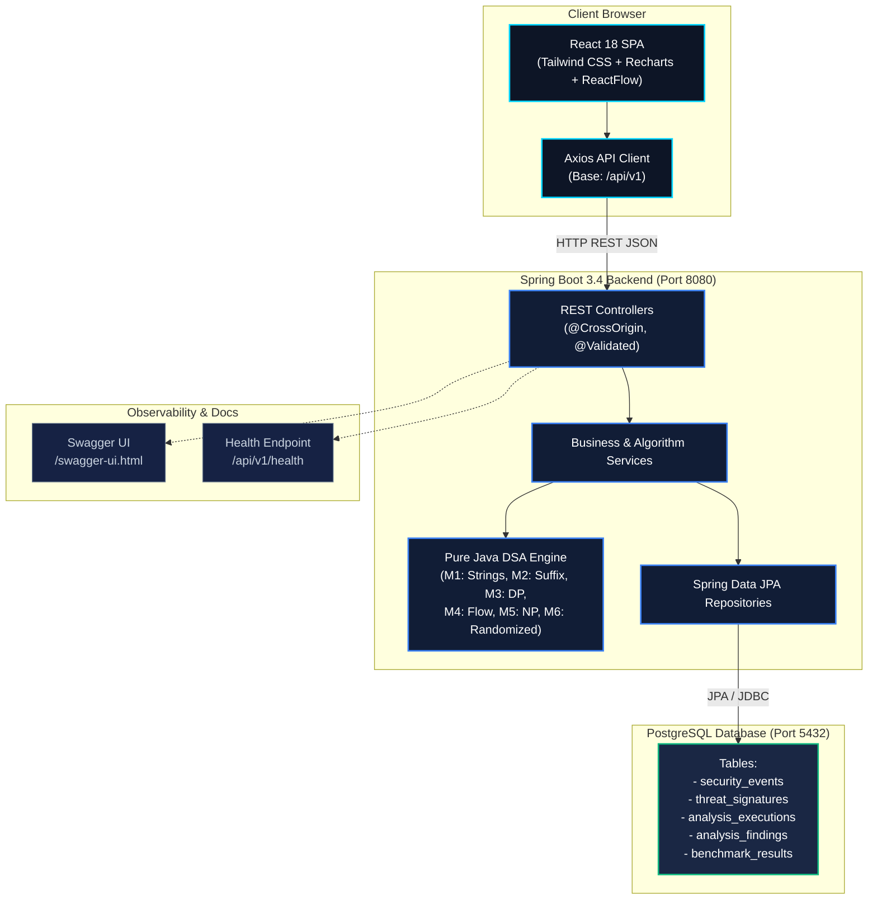
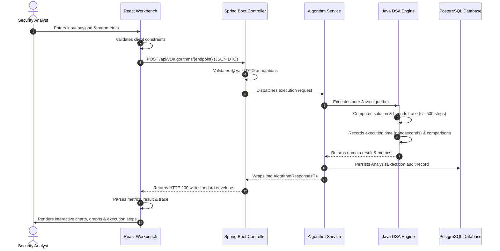
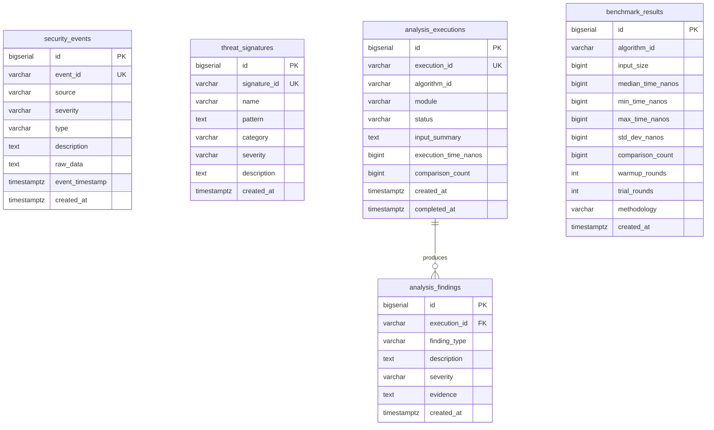

<div align="center">

# CyberShield
### Cybersecurity Analytics & Algorithmic Intelligence Platform

[](https://openjdk.org/)
[](https://spring.io/projects/spring-boot)
[](https://react.dev/)
[](https://www.typescriptlang.org/)
[](https://vitejs.dev/)
[](https://tailwindcss.com/)
[](https://www.postgresql.org/)
[](https://www.docker.com/)
[](backend/src/test/java/com/cybershield)

<p align="center">
  <strong>A high-performance full-stack intelligence platform demonstrating foundational and advanced Data Structures & Algorithms applied to enterprise security telemetry, signature matching, graph containment, and optimization problems.</strong>
</p>

<p align="center">
  <a href="#project-overview">Overview</a> •
  <a href="#key-features">Key Features</a> •
  <a href="#algorithms--technical-implementations">Algorithms</a> •
  <a href="#system-architecture">Architecture</a> •
  <a href="#api-documentation">API Reference</a> •
  <a href="#database-design">Database</a> •
  <a href="#installation--getting-started">Getting Started</a> •
  <a href="#testing--quality-assurance">Testing</a> •
  <a href="#deployment-guide">Deployment</a>
</p>

</div>

---

## Project Overview

Modern Security Operations Centers (SOCs) and detection pipelines process millions of events per second. Evaluating threats, inspecting payload streams, parsing malware signatures, and partitioning compromised network topology requires rigorous algorithmic complexity guarantees.

**CyberShield** is an engineering platform that connects classical and advanced computer science algorithms with practical cybersecurity workflows. Rather than treating Data Structures and Algorithms (DSA) as isolated academic exercises, CyberShield integrates them into an end-to-end analytics platform featuring:

1. **Pure Java Algorithmic Compute Engine:** 26 algorithm implementations across 6 technical modules executing on Spring Boot 3.4 with nanosecond precision metrics, bounded execution tracing, and comparison counters.
2. **Interactive Analyst Dashboard:** A reactive single-page React 18 + TypeScript application equipped with real-time parameter configuration, step-by-step trace inspection, Cytoscape/ReactFlow network graphs, and Recharts performance plots.
3. **Structured Event Persistence:** PostgreSQL schema storing security event telemetry, threat signature definitions, historical execution audits, and micro-benchmarking profiles.
4. **Standardized Execution Envelope:** Every algorithm returns a typed JSON envelope containing unique execution IDs, detailed execution traces, operation metrics, and status telemetry.

> [!NOTE]
> All algorithms in CyberShield execute on the Java backend. The React frontend does not fake or emulate algorithm logic—it displays live metrics, state graphs, and traces calculated in memory by the Spring Boot service.

---

## Key Features

| Capability | Technical Implementation | Practical Benefit |
| :--- | :--- | :--- |
| **High-Throughput Pattern Search** | KMP, Z-Algorithm, Rabin-Karp, Aho-Corasick | Multi-pattern inspection across HTTP payloads, syslog streams, and IDS rules without quadratic backtracking. |
| **Full-Text Substring Indexing** | Suffix Arrays, SA-IS ($O(n)$ induced sorting), Kasai LCP, Suffix Automaton | Fast substring indexing and repeat-sequence detection across large memory dumps and packet captures. |
| **Dynamic Optimization** | Levenshtein, Damerau OSA, Weighted Distance, Bitmask DP, Matrix Chain | Quantifies command-line typosquatting distance, selects minimum-cost security controls, and optimizes transformation pipelines. |
| **Network Flow & Containment** | Ford-Fulkerson, Edmonds-Karp, Dinic's, Bipartite Matching, Min-Cut | Models network bandwidth bottlenecks, computes minimal-cut firewall isolation barriers, and matches alerts to analysts. |
| **Logic & Complexity Solvers** | DPLL SAT Solver, Polynomial-Time Reductions, Vertex Cover 2-Approx | Formulates policy satisfiability, evaluates NP-hard constraint verification, and computes near-optimal sensor placements. |
| **Statistical & Parallel Compute** | Miller-Rabin, Randomized QuickSort, Reservoir Sampling, Blelloch Scan | Probabilistic key testing, streaming memory log sampling, and work-depth parallel prefix tree reductions. |
| **Micro-Benchmarking Engine** | Multi-round JVM warmup with median, min, max, and standard deviation timing | Measures real JVM execution overhead, cache warming effects, and algorithmic scale under varying payload sizes. |
| **Telemetry Explorer** | PostgreSQL JPA persistence with paginated REST endpoints | Ingests, filters, and searches security events across severity tiers (`LOW`, `MEDIUM`, `HIGH`, `CRITICAL`). |

---

## Algorithms & Technical Implementations

All algorithm implementations are self-contained, unit-tested, and located under [`backend/src/main/java/com/cybershield/algorithms/`](backend/src/main/java/com/cybershield/algorithms).

```
algorithms/
├── strings/       # M1: Exact Pattern Matching & Multi-Pattern Tries
├── suffix/        # M2: Suffix Structures, Suffix Automaton & LCP
├── dp/            # M3: Distance Metrics, Bitmask Cover & Matrix Chain
├── graph/         # M4: Maximum Flow, Min-Cut & Bipartite Matching
├── np/            # M5: Satisfiability, NP Reductions & Approximations
└── randomized/    # M6: Primality, Streaming Sampling & Parallel Scans
```

### 1. String Processing & Pattern Matching

| Algorithm | Problem Solved | Security Role | Time Complexity | Space Complexity | Source File |
| :--- | :--- | :--- | :--- | :--- | :--- |
| **Knuth–Morris–Pratt (KMP)** | Single-pattern search using Longest Prefix Suffix (LPS) precomputation. | Scans system logs and firewall traces for known signature strings without resetting text pointer. | $O(n + m)$ | $O(m)$ | [`KmpAlgorithm.java`](backend/src/main/java/com/cybershield/algorithms/strings/KmpAlgorithm.java) |
| **Z-Algorithm** | Computes the length of the longest substring starting from each index matching the prefix. | Fast anomaly detection in structured network headers and payload boundary alignment. | $O(n + m)$ | $O(n + m)$ | [`ZFunctionAlgorithm.java`](backend/src/main/java/com/cybershield/algorithms/strings/ZFunctionAlgorithm.java) |
| **Rabin–Karp** | Rolling polynomial hash (base 31, prime $10^9+7$) with direct character verification on match. | Rapid preliminary scanning across document streams with collision and spurious-hit tracking. | Average: $O(n + m)$<br>Worst: $O(nm)$ | $O(1)$ auxiliary | [`RabinKarpAlgorithm.java`](backend/src/main/java/com/cybershield/algorithms/strings/RabinKarpAlgorithm.java) |
| **Aho–Corasick** | Multi-pattern dictionary matching using a Trie with BFS failure and output link transitions. | Simultaneous detection of multiple intrusion signatures (e.g., SQLi, XSS, Path Traversal) in a single linear pass. | $O(n + \sum m_i + z)$ | $O(\sum m_i \cdot \Sigma)$ | [`AhoCorasickAlgorithm.java`](backend/src/main/java/com/cybershield/algorithms/strings/AhoCorasickAlgorithm.java) |

### 2. Suffix Structures & Substring Indexing

| Algorithm | Problem Solved | Security Role | Time Complexity | Space Complexity | Source File |
| :--- | :--- | :--- | :--- | :--- | :--- |
| **Suffix Array** | Lexicographical ordering of all suffixes in a string via comparator-based sorting. | Substring indexation enabling binary search queries over memory dumps and binary buffers. | $O(n \log^2 n)$ | $O(n)$ | [`SuffixArrayAlgorithm.java`](backend/src/main/java/com/cybershield/algorithms/suffix/SuffixArrayAlgorithm.java) |
| **SA-IS Algorithm** | Linear-time Suffix Array construction via Induced Sorting (S-type, L-type, and LMS substrings). | High-scale indexing for large static datasets and long network captures. | $O(n)$ | $O(n)$ | [`SaisAlgorithm.java`](backend/src/main/java/com/cybershield/algorithms/suffix/SaisAlgorithm.java) |
| **Kasai LCP** | Computes the Longest Common Prefix array from a text and its Suffix Array. | Detects repeated sequences, polymorphic shellcode loops, and repeated protocol fragments. | $O(n)$ | $O(n)$ | [`LcpKasaiAlgorithm.java`](backend/src/main/java/com/cybershield/algorithms/suffix/LcpKasaiAlgorithm.java) |
| **Suffix Automaton (SAM)** | Minimal deterministic automaton recognizing all substrings of a string (DAWG). | Substring acceptance verification in $O(m)$ time with linear state transitions. | Construction: $O(n)$<br>Query: $O(m)$ | $O(n \cdot \Sigma)$ | [`SuffixAutomatonAlgorithm.java`](backend/src/main/java/com/cybershield/algorithms/suffix/SuffixAutomatonAlgorithm.java) |

### 3. Dynamic Programming & Resource Optimization

| Algorithm | Problem Solved | Security Role | Time Complexity | Space Complexity | Source File |
| :--- | :--- | :--- | :--- | :--- | :--- |
| **Edit Distance** | Computes minimum edit operations under Levenshtein, Damerau OSA, and Weighted costs. | Detects typosquatting domain attacks, obfuscated command-line invocations, and evasive binaries. | $O(mn)$ | $O(mn)$ | [`EditDistanceAlgorithm.java`](backend/src/main/java/com/cybershield/algorithms/dp/EditDistanceAlgorithm.java) |
| **Bitmask DP** | Finds the minimum-cost subset of security rules that covers all required compliance policies. | Security control cost minimization across $2^n$ state spaces (bounded to $n \le 20$). | $O(m \cdot 2^n)$ | $O(2^n)$ | [`BitmaskDpAlgorithm.java`](backend/src/main/java/com/cybershield/algorithms/dp/BitmaskDpAlgorithm.java) |
| **Matrix Chain** | Computes the optimal parenthesization order to minimize scalar multiplications. | Optimizes multi-stage cryptographic transformations and serial pipeline evaluation. | $O(n^3)$ | $O(n^2)$ | [`MatrixChainAlgorithm.java`](backend/src/main/java/com/cybershield/algorithms/dp/MatrixChainAlgorithm.java) |

### 4. Graph Algorithms & Network Flow Analysis

| Algorithm | Problem Solved | Security Role | Time Complexity | Space Complexity | Source File |
| :--- | :--- | :--- | :--- | :--- | :--- |
| **Ford–Fulkerson** | Augmenting path search via Depth-First Search on residual capacities. | Baseline throughput modeling across network topology links. | $O(E \cdot f_{\max})$ | $O(V + E)$ | [`MaxFlowAlgorithm.java`](backend/src/main/java/com/cybershield/algorithms/graph/MaxFlowAlgorithm.java) |
| **Edmonds–Karp** | Breadth-First Search shortest augmenting paths on residual graphs. | Network bottleneck detection and denial-of-service link saturation analysis. | $O(V \cdot E^2)$ | $O(V + E)$ | [`EdmondsKarpAlgorithm.java`](backend/src/main/java/com/cybershield/algorithms/graph/EdmondsKarpAlgorithm.java) |
| **Dinic’s Algorithm** | Level-graph construction via BFS and blocking flow resolution using DFS with current-edge pointers. | High-capacity traffic modeling across large multi-tier corporate architectures. | $O(V^2 \cdot E)$ | $O(V + E)$ | [`DinicsAlgorithm.java`](backend/src/main/java/com/cybershield/algorithms/graph/DinicsAlgorithm.java) |
| **Bipartite Matching** | Maximum matching on unweighted bipartite graphs via augmenting paths. | Optimal pairing of incoming high-priority alerts with available SOC triage analysts. | $O(V \cdot E)$ | $O(V + E)$ | [`BipartiteMatchingAlgorithm.java`](backend/src/main/java/com/cybershield/algorithms/graph/BipartiteMatchingAlgorithm.java) |
| **Minimum Cut** | Derives minimum capacity edge cut separating Source from Sink in residual graphs. | Identifies optimal firewall choke points to isolate compromised segments with minimum capacity loss. | Same as Max Flow | $O(V + E)$ | [`MinCutAlgorithm.java`](backend/src/main/java/com/cybershield/algorithms/graph/MinCutAlgorithm.java) |

### 5. Computational Logic & Complexity Reductions

| Algorithm | Problem Solved | Security Role | Time Complexity | Space Complexity | Source File |
| :--- | :--- | :--- | :--- | :--- | :--- |
| **DPLL SAT Solver** | Exhaustive Davis-Putnam-Logemann-Loveland backtracking with unit propagation. | Evaluates whether access control policy matrices contain conflicting or satisfiable conditions. | $O(2^v)$ worst-case | $O(v + c)$ | [`SatSolverAlgorithm.java`](backend/src/main/java/com/cybershield/algorithms/np/SatSolverAlgorithm.java) |
| **Reduction Engine** | Polynomial transformations: 3-SAT $\to$ CLIQUE $\to$ Independent Set $\to$ Vertex Cover. | Demonstrates computational equivalence across security constraint verification problems. | Polynomial in input | Polynomial in input | [`ReductionAlgorithm.java`](backend/src/main/java/com/cybershield/algorithms/np/ReductionAlgorithm.java) |
| **Vertex Cover 2-Approx** | Greedy maximal edge selection delivering a vertex cover at most $2\times$ optimal. | Near-optimal placement of network packet sniffers and intrusion monitors on network edge graphs. | $O(V + E)$ | $O(V)$ | [`ReductionAlgorithm.java`](backend/src/main/java/com/cybershield/algorithms/np/ReductionAlgorithm.java) |

### 6. Number Theory, Randomized & Parallel Algorithms

| Algorithm | Problem Solved | Security Role | Time Complexity | Space Complexity | Source File |
| :--- | :--- | :--- | :--- | :--- | :--- |
| **Miller–Rabin** | Probabilistic primality test using random modular exponentiation witnesses. | Fast candidate verification for cryptographic prime generation and RSA key parameters. | $O(k \log^3 n)$ | $O(\log n)$ | [`MillerRabinAlgorithm.java`](backend/src/main/java/com/cybershield/algorithms/randomized/MillerRabinAlgorithm.java) |
| **Randomized QuickSort** | Uniformly random pivot selection with bounded recursion step tracing. | Las Vegas sorting with guaranteed correct order and protection against adversarial worst-case inputs. | Expected: $O(n \log n)$ | $O(\log n)$ call stack | [`RandomizedQuickSortAlgorithm.java`](backend/src/main/java/com/cybershield/algorithms/randomized/RandomizedQuickSortAlgorithm.java) |
| **Reservoir Sampling** | Algorithm R selecting $k$ uniform random samples from an unknown/unbounded stream. | Unbiased statistical telemetry sampling from massive continuous firewall and packet feeds. | $O(n)$ | $O(k)$ | [`ReservoirSamplingAlgorithm.java`](backend/src/main/java/com/cybershield/algorithms/randomized/ReservoirSamplingAlgorithm.java) |
| **Blelloch Parallel Scan** | Tree-based Up-Sweep (reduction) and Down-Sweep (prefix distribution) scan. | Educational parallel model of high-throughput log aggregation and parallel counter prefixing. | Work: $O(n)$<br>Span: $O(\log n)$ | $O(n)$ | [`ParallelScanAlgorithm.java`](backend/src/main/java/com/cybershield/algorithms/randomized/ParallelScanAlgorithm.java) |
| **Brent’s Theorem Calculator** | Evaluates PRAM execution bounds: $T_p \le \frac{W - D}{p} + D$. | Theoretical performance estimation for parallel threat correlation across multiprocessor nodes. | $O(1)$ | $O(1)$ | [`BrentsTheoremCalculator.java`](backend/src/main/java/com/cybershield/algorithms/randomized/BrentsTheoremCalculator.java) |

---

## Technology Stack

```
┌────────────────────────────────────────────────────────────────────────┐
│                          PRESENTATION LAYER                            │
│  React 18.3 • TypeScript 5.6 • Vite 6.4 • Tailwind CSS 3.4            │
│  Recharts 2.15 • ReactFlow 11.11 • Lucide Icons                        │
└───────────────────────────────────┬────────────────────────────────────┘
                                    │ HTTP / REST (Axios)
┌───────────────────────────────────▼────────────────────────────────────┐
│                           SERVICES LAYER                               │
│  Spring Boot 3.4.3 • Java 21 LTS • Spring Web • Spring Data JPA        │
│  Spring Validation • SpringDoc OpenAPI 2.8.5 • Project Lombok          │
└───────────────────┬────────────────────────────────┬───────────────────┘
                    │ In-Memory                      │ SQL (HikariCP)
┌───────────────────▼──────────────┐ ┌───────────────▼───────────────────┐
│         COMPUTE ENGINE           │ │        PERSISTENCE LAYER          │
│  Pure Java DSA Engine (M1 - M6)  │ │  PostgreSQL 15+                   │
│  JUnit 5 Tests (44 test suites)  │ │  5 Relational Entities & Indexes  │
└──────────────────────────────────┘ └───────────────────────────────────┘
```

| Layer | Technology | Version | Purpose & Responsibility |
| :--- | :--- | :--- | :--- |
| **Frontend Framework** | React | `18.3.1` | Component-based reactive user interface |
| **Language (Frontend)** | TypeScript | `5.6.3` | Type-safe state management, contracts, and DTO handling |
| **Build & Bundler** | Vite | `6.4.4` | Development server, ES module transforms, production bundle |
| **Styling** | Tailwind CSS | `3.4.17` | Dark-mode cybersecurity UI theme, responsive panels |
| **Visualization** | Recharts & ReactFlow | `2.15.4` / `11.11.4` | Performance metric charts and interactive network flow graphs |
| **Backend Framework** | Spring Boot | `3.4.3` | Enterprise REST API, dependency injection, and JPA management |
| **Language (Backend)** | Java (OpenJDK) | `21 LTS` | Pure backend algorithmic execution engine |
| **Database** | PostgreSQL | `15+` | Persistent storage of events, signatures, and execution audits |
| **API Specification** | SpringDoc OpenAPI | `2.8.5` | Automated Swagger UI docs and OpenAPI v3 contracts |
| **Testing** | JUnit 5 & Mockito | `5.11.4` | Automated unit testing and integration verification |
| **Containerization** | Docker & Compose | `3.8+` | Isolated multi-container deployment architecture |

---

## System Architecture

The following diagram illustrates the complete architectural request-processing lifecycle:



---

## Application Workflow

A representative algorithm request (such as intrusion signature matching or min-cut network partitioning) follows this sequence:



---

## Project Structure

```text
CyberShield/
├── .env.example                               # Root environment template
├── .gitignore                                 # Git exclusion rules
├── CYBERSHIELD_IMPLEMENTATION_STRATEGY.md     # Engineering specification
├── docker-compose.yml                         # Containerized multi-service deployment
├── PROJECT_STATUS.md                          # Technical implementation status audit
├── README.md                                  # Platform documentation
├── backend/
│   ├── Dockerfile                             # Multi-stage Java 21 build
│   ├── .gitignore                             # Backend ignore rules
│   ├── mvnw / mvnw.cmd                        # Maven wrapper scripts
│   ├── pom.xml                                # Maven build & dependencies
│   ├── .mvn/wrapper/                          # Maven wrapper configuration
│   └── src/
│       ├── main/
│       │   ├── java/com/cybershield/
│       │   │   ├── CyberShieldApplication.java# Spring Boot entry point
│       │   │   ├── algorithms/                # 26 Pure Java DSA algorithms (M1-M6)
│       │   │   ├── config/                    # WebConfig (CORS), OpenApiConfig
│       │   │   ├── controller/                # 12 REST API controllers
│       │   │   ├── dto/                       # Typed request/response records
│       │   │   ├── exception/                 # Global exception handler
│       │   │   ├── model/                     # 5 JPA entities
│       │   │   ├── repository/                # 5 Spring Data JPA interfaces
│       │   │   └── service/                   # 8 Algorithm & business services
│       │   └── resources/
│       │       ├── application.properties     # Backend configuration
│       │       ├── data.sql                   # Synthetic security event seed data
│       │       └── schema.sql                 # DDL table creation script
│       └── test/
│           ├── java/com/cybershield/          # 13 JUnit 5 test classes (44 tests)
│           └── resources/
│               └── application.properties     # H2 test database configuration
├── database/
│   └── init.sql                               # PostgreSQL container initialization
├── docs/
│   ├── API.md                                 # Full REST API documentation
│   ├── ARCHITECTURE.md                        # Architectural specification
│   └── TESTING.md                             # Test matrix and QA verification
└── frontend/
    ├── Dockerfile                             # Multi-stage Node + Nginx build
    ├── .env.example                           # Frontend environment template
    ├── .gitignore                             # Frontend ignore rules
    ├── index.html                             # Single-page HTML entry point
    ├── package.json                           # Frontend npm dependencies
    ├── package-lock.json                      # Deterministic dependency lockfile
    ├── postcss.config.js                      # PostCSS pipeline
    ├── tailwind.config.js                     # Tailwind theme configuration
    ├── tsconfig*.json                         # TypeScript compiler configurations
    ├── vite.config.ts                         # Vite development & build setup
    ├── public/
    │   └── shield.svg                         # Vector branding asset
    └── src/
        ├── App.tsx                            # Root routing & layout
        ├── index.css                          # Global styles & scrollbars
        ├── main.tsx                           # React DOM mount point
        ├── components/
        │   ├── layout/                        # Sidebar, TopBar, AppLayout
        │   └── ui/                            # MetricCard, TraceViewer, CodeBlock, etc.
        ├── pages/
        │   ├── Overview.tsx                   # System health & metric dashboard
        │   ├── DataExplorer.tsx               # Security event log explorer
        │   ├── AlgorithmLab.tsx               # Algorithm selection catalog
        │   ├── NetworkAnalysis.tsx            # Interactive flow graph editor
        │   ├── Benchmarking.tsx               # Empirical runtime benchmarking
        │   ├── ExecutionHistory.tsx           # Audit log table
        │   ├── Reports.tsx                    # Executive summary reports
        │   ├── Settings.tsx                   # Service status & settings
        │   └── algorithms/                    # 16 Interactive DSA workbenches
        ├── services/api.ts                    # Axios API client
        └── types/index.ts                     # TypeScript interfaces & types
```

---

## API Documentation

The Spring Boot backend exposes a REST API structured under `/api/v1`.

### Standard Response Envelope

All algorithm execution endpoints return an `AlgorithmResponse<T>` wrapper:

```json
{
  "executionId": "b6a8f12c-4e3a-4a27-a12b-8a5e7b8c9d0e",
  "algorithmId": "KMP",
  "status": "SUCCESS",
  "result": {
    "matchPositions": [10, 42],
    "lpsArray": [0, 0, 1, 2, 0, 1, 2, 3, 4],
    "patternLength": 9
  },
  "metrics": {
    "executionTimeNanos": 124500,
    "comparisonCount": 68,
    "inputSize": 1024
  },
  "trace": [
    "i=10, j=0, match: text[10]='S' == pattern[0]='S'",
    "i=11, j=1, match: text[11]='Q' == pattern[1]='Q'",
    "Match found at index 10"
  ],
  "warnings": [],
  "timestamp": "2026-10-14T19:00:00.000Z",
  "error": null
}
```

### Core API Endpoints

| Category | Method | Endpoint | Description | Request Body Highlights |
| :--- | :--- | :--- | :--- | :--- |
| **System** | `GET` | `/api/v1/health` | Backend & database health check | None |
| **Dashboard** | `GET` | `/api/v1/dashboard/overview` | Summary counts, executions, status | None |
| **Catalog** | `GET` | `/api/v1/algorithms` | List of all 26 registered algorithms | None |
| **M1 String** | `POST` | `/api/v1/algorithms/kmp` | Knuth–Morris–Pratt search | `{"text": "...", "pattern": "..."}` |
| **M1 String** | `POST` | `/api/v1/algorithms/z-function` | Z-Algorithm search | `{"text": "...", "pattern": "..."}` |
| **M1 String** | `POST` | `/api/v1/algorithms/rabin-karp` | Rabin–Karp rolling hash search | `{"text": "...", "pattern": "..."}` |
| **M1 String** | `POST` | `/api/v1/algorithms/aho-corasick` | Multi-pattern dictionary search | `{"text": "...", "patterns": ["...", "..."]}` |
| **M2 Suffix** | `POST` | `/api/v1/algorithms/suffix-array` | Suffix Array construction | `{"text": "...", "query": "..."}` |
| **M2 Suffix** | `POST` | `/api/v1/algorithms/sa-is` | SA-IS linear Suffix Array | `{"text": "..."}` |
| **M2 Suffix** | `POST` | `/api/v1/algorithms/lcp-kasai` | Kasai Longest Common Prefix | `{"text": "..."}` |
| **M2 Suffix** | `POST` | `/api/v1/algorithms/suffix-automaton`| Suffix Automaton DAWG | `{"text": "...", "query": "..."}` |
| **M3 DP** | `POST` | `/api/v1/algorithms/edit-distance` | Levenshtein / OSA / Weighted DP | `{"str1": "...", "str2": "...", "variant": "LEVENSHTEIN"}` |
| **M3 DP** | `POST` | `/api/v1/algorithms/bitmask-dp` | Security control subset optimization | `{"rules": [...], "requiredPolicies": [...]}` |
| **M3 DP** | `POST` | `/api/v1/algorithms/matrix-chain` | Matrix chain multiplication | `{"dimensions": [10, 30, 5, 60, 20]}` |
| **M4 Flow** | `POST` | `/api/v1/algorithms/max-flow` | Max flow (Ford-Fulkerson / Dinic) | `{"nodes": 6, "edges": [...], "source": 0, "sink": 5}` |
| **M4 Flow** | `POST` | `/api/v1/algorithms/bipartite-matching`| Analyst alert bipartite assignment | `{"leftCount": 4, "rightCount": 4, "edges": [...]}` |
| **M4 Flow** | `POST` | `/api/v1/algorithms/min-cut` | Minimum cut network partition | `{"nodes": 6, "edges": [...], "source": 0, "sink": 5}` |
| **M5 Logic** | `POST` | `/api/v1/algorithms/sat` | DPLL Satisfiability solver | `{"numVariables": 3, "clauses": [[1,-2],[2,3]]}` |
| **M5 Logic** | `POST` | `/api/v1/algorithms/reductions` | 3-SAT to CLIQUE / IS / VC chain | `{"clauses": [[1,2,3],[-1,2,-3]]}` |
| **M5 Logic** | `POST` | `/api/v1/algorithms/vertex-cover` | Vertex Cover 2-approximation | `{"nodes": 6, "edges": [...]}` |
| **M6 Random** | `POST` | `/api/v1/algorithms/miller-rabin` | Miller-Rabin primality check | `{"n": 1000000007, "rounds": 10}` |
| **M6 Random** | `POST` | `/api/v1/algorithms/randomized-quicksort`| Partition-traced Las Vegas sort | `{"array": [64, 34, 25, 12, 22, 11, 90]}` |
| **M6 Random** | `POST` | `/api/v1/algorithms/reservoir-sampling`| Algorithm R stream sampling | `{"stream": [...], "reservoirSize": 5}` |
| **M6 Random** | `POST` | `/api/v1/algorithms/parallel-scan`| Blelloch exclusive prefix scan | `{"array": [1, 2, 3, 4, 5, 6, 7, 8], "operation": "ADD"}` |
| **M6 Random** | `POST` | `/api/v1/algorithms/brents-theorem`| PRAM work-depth speedup estimation | `{"work": 10000, "depth": 14, "processors": 16}` |
| **Benchmark** | `POST` | `/api/v1/algorithms/benchmark` | Multi-round JVM runtime benchmark | `{"algorithmId": "KMP", "text": "...", "pattern": "..."}` |
| **Events** | `GET` | `/api/v1/events` | Paginated security event logs | `?page=0&size=20&severity=HIGH` |
| **Audits** | `GET` | `/api/v1/executions` | Historical algorithm execution audits | `?page=0&size=20&algorithmId=KMP` |

### Sample `curl` Invocation

```bash
curl -X POST http://localhost:8080/api/v1/algorithms/kmp \
  -H "Content-Type: application/json" \
  -d '{"text": "OCT-14-2026: Failed password for root from 192.168.1.105", "pattern": "Failed password"}'
```

### Interactive API Explorer
When the backend is running, the interactive Swagger UI documentation is accessible at:  
👉 **http://localhost:8080/swagger-ui.html**

---

## Database Design

CyberShield utilizes PostgreSQL for persistent storage.



### Synthetic Data Disclosure

> [!IMPORTANT]
> The seeded data in [`backend/src/main/resources/data.sql`](backend/src/main/resources/data.sql) and [`database/init.sql`](database/init.sql) consists of **synthetic test events** (e.g., standard EICAR antivirus test strings, RFC 5737 test subnets, textbook SQL injection tautologies `' OR '1'='1`). They do not represent real-world compromised infrastructure, proprietary threat intelligence, or personally identifiable information.

---

## Installation & Getting Started

### Prerequisites

- **Java Development Kit (JDK):** Version 21 LTS or newer
- **Node.js:** Version 18.x or newer (Node 20+ recommended)
- **Package Manager:** npm 9+
- **Database:** PostgreSQL 15+ (or Docker)

### Option 1: Native Local Setup

#### 1. Clone the Repository
```bash
git clone https://github.com/<your-username>/CyberShield.git
cd CyberShield
```

#### 2. Configure Environment Variables
Copy the template configuration files:
```powershell
# Copy root environment template
Copy-Item .env.example .env

# Copy frontend environment template
Copy-Item frontend/.env.example frontend/.env
```

#### 3. Initialize PostgreSQL Database
Ensure PostgreSQL is running on port `5432`, then create the database:
```sql
CREATE DATABASE cybershield;
```
*(Tables and initial seed data will automatically be populated by Spring Boot upon first boot via `schema.sql` and `data.sql`.)*

#### 4. Launch the Spring Boot Backend
```powershell
cd backend
$env:DB_PASSWORD = "your_local_postgres_password"
.\mvnw.cmd spring-boot:run
```
*The backend starts at **http://localhost:8080**.*

#### 5. Launch the React Frontend
Open a new terminal window:
```powershell
cd frontend
npm install
npm run dev
```
*The frontend dashboard opens at **http://localhost:5173**.*

---

### Option 2: Docker Compose Setup

Run the complete platform (PostgreSQL, Spring Boot backend, and React frontend) in isolated containers:

```powershell
# Set your local database password in the shell
$env:DB_PASSWORD = "your_secure_password"

# Launch all services
docker compose up -d --build
```

| Service | Container Name | Host Port | Internal Port | Status Endpoint |
| :--- | :--- | :--- | :--- | :--- |
| **PostgreSQL** | `cybershield-postgres` | `5433` | `5432` | `pg_isready -U postgres` |
| **Backend** | `cybershield-backend` | `8080` | `8080` | `http://localhost:8080/api/v1/health` |
| **Frontend** | `cybershield-frontend` | `5173` | `80` | `http://localhost:5173` |

To stop all services:
```bash
docker compose down
```

---

## Configuration Reference

The application reads configuration through standard environment variables:

| Variable Name | Component | Description | Default / Example | Required |
| :--- | :--- | :--- | :--- | :--- |
| `DB_PASSWORD` | Backend & Docker | PostgreSQL authentication password | `replace_with_your_local_password` | **Yes** |
| `SPRING_DATASOURCE_URL` | Backend | JDBC connection string | `jdbc:postgresql://localhost:5432/cybershield` | No |
| `SPRING_DATASOURCE_USERNAME` | Backend | PostgreSQL username | `postgres` | No |
| `SERVER_PORT` | Backend | Spring Boot HTTP port | `8080` | No |
| `VITE_API_URL` | Frontend | Backend API endpoint base URL | `http://localhost:8080/api/v1` | No |

---

## Testing & Quality Assurance

CyberShield maintains an automated test suite verifying edge cases, boundary conditions, and recurrence relations across all algorithm modules:

```powershell
# Run the full JUnit 5 backend test suite (from the backend directory)
cd backend
.\mvnw.cmd test
```

### Verified Test Matrix (44 Tests, 100% Pass Rate)

| Test Suite | Module | Tests | Validation Scope |
| :--- | :--- | :--- | :--- |
| [`KmpAlgorithmTest`](backend/src/test/java/com/cybershield/KmpAlgorithmTest.java) | M1: Strings | 7 | LPS boundary transitions, overlapping matches (`"aa"` in `"aaaa"`), empty patterns |
| [`ZFunctionAlgorithmTest`](backend/src/test/java/com/cybershield/ZFunctionAlgorithmTest.java) | M1: Strings | 4 | Z-box boundary traversal, concatenation with `$` delimiter, zero-match strings |
| [`RabinKarpAlgorithmTest`](backend/src/test/java/com/cybershield/RabinKarpAlgorithmTest.java) | M1: Strings | 3 | Negative modulo arithmetic, collision handling, character verification |
| [`AhoCorasickAlgorithmTest`](backend/src/test/java/com/cybershield/AhoCorasickAlgorithmTest.java) | M1: Strings | 3 | Multi-pattern dictionary trie, BFS failure link loops, output link accumulation |
| [`SuffixArrayTest`](backend/src/test/java/com/cybershield/SuffixArrayTest.java) | M2: Suffix | 3 | Lexicographical suffix order verification, binary search pattern queries |
| [`SaisAlgorithmTest`](backend/src/test/java/com/cybershield/SaisAlgorithmTest.java) | M2: Suffix | 2 | SA-IS induced sorting $O(n)$ verified against comparator sort baseline |
| [`LcpKasaiAlgorithmTest`](backend/src/test/java/com/cybershield/LcpKasaiAlgorithmTest.java) | M2: Suffix | 1 | Kasai $O(n)$ linear LCP calculation matching suffix array ordering |
| [`EditDistanceTest`](backend/src/test/java/com/cybershield/EditDistanceTest.java) | M3: DP | 4 | Levenshtein matrix, Damerau OSA adjacent transpositions, weighted cost matrices |
| [`MatrixChainTest`](backend/src/test/java/com/cybershield/MatrixChainTest.java) | M3: DP | 3 | CLRS matrix recurrence (verifies 15,125 optimal ops), split tables, parens string |
| [`BitmaskDpAlgorithmTest`](backend/src/test/java/com/cybershield/BitmaskDpAlgorithmTest.java) | M3: DP | 1 | Minimum cost subset security rule coverage across $2^n$ state space |
| [`MaxFlowTest`](backend/src/test/java/com/cybershield/MaxFlowTest.java) | M4: Flow | 4 | Classic CLRS network flow verifying max flow 23 on Ford-Fulkerson, Edmonds-Karp, Dinic, and Min-Cut |
| [`SatSolverAlgorithmTest`](backend/src/test/java/com/cybershield/SatSolverAlgorithmTest.java) | M5: Logic | 3 | DPLL unit propagation, satisfying truth assignment, contradiction refutation |
| [`MillerRabinAlgorithmTest`](backend/src/test/java/com/cybershield/MillerRabinAlgorithmTest.java) | M6: Random | 2 | Prime verification, composite detection, Carmichael number 561 non-prime proof |
| [`ParallelScanAlgorithmTest`](backend/src/test/java/com/cybershield/ParallelScanAlgorithmTest.java) | M6: Random | 2 | Blelloch exclusive prefix scan tree: Up-Sweep reduction and Down-Sweep distribution |
| [`BrentsTheoremCalculatorTest`](backend/src/test/java/com/cybershield/BrentsTheoremCalculatorTest.java)| M6: Random | 1 | Theoretical PRAM work-depth speedup estimation bounds |
| [`CyberShieldApplicationTests`](backend/src/test/java/com/cybershield/CyberShieldApplicationTests.java)| Full System | 1 | Spring context initialization, bean wiring, datasource configuration |

### Frontend Build & Type Validation
```powershell
cd frontend
npm run build
```
*Runs `tsc -b` and `vite build`. Transforms 2,424 modules with zero TypeScript errors.*

---

## Deployment Guide

### Production Best Practices

1. **Reverse Proxy (Nginx / Cloudflare):** Place an SSL-terminating reverse proxy in front of the frontend (port 80) and backend (port 8080).
2. **CORS Configuration:** Update [`WebConfig.java`](backend/src/main/java/com/cybershield/config/WebConfig.java) with your production domain instead of `localhost:5173`.
3. **Database Secrets:** Never bake database passwords into Docker images. Pass `DB_PASSWORD` securely through Docker secrets, Kubernetes secrets, or environment injection.
4. **JVM Memory Limits:** For containerized backend deployment, allocate at least 1 GB RAM:
   ```bash
   java -XX:MaxRAMPercentage=75.0 -jar app.jar
   ```

---

## Security & Limitations

1. **Synthetic Telemetry:** Seeded security events and threat signatures are designed for algorithm validation and educational evaluation. They do not constitute a live threat intelligence feed.
2. **Deterministic vs. Probabilistic:** The Miller–Rabin algorithm is probabilistic; it proves compositeness deterministically but reports "probable prime" for inputs where witness tests pass.
3. **SAT Solver Boundary:** The DPLL solver uses exhaustive backtracking. It is intended for policy verification with $\le 20$ variables and will exhibit exponential latency on production-scale industrial SAT instances.
4. **Edit Distance Variant:** The Damerau-Levenshtein implementation follows the **Optimal String Alignment (OSA)** algorithm, which permits adjacent character transpositions but restricts substring edits to at most once per character.
5. **Parallel Scan Model:** The Blelloch scan workbench visualizes theoretical tree phases (Up-Sweep and Down-Sweep) for algorithmic analysis. It is not an OpenCL/CUDA hardware kernel.

---

## Visual Documentation & UI Workbenches

CyberShield provides a dedicated dark-themed UI for each algorithm category:

```
┌────────────────────────────────────────────────────────────────────────┐
│  CyberShield Analytics Platform                           Status: UP   │
├─────────────┬──────────────────────────────────────────────────────────┤
│  OVERVIEW   │  Module: M1 Pattern Matching - KMP Workbench             │
│  EXPLORER   │  ┌────────────────────────────────────────────────────┐  │
│  LAB (M1-M6)│  │ Text: [OCT-14-2026: Failed password for root...]   │  │
│  FLOW GRAPH │  │ Pattern: [Failed password]        [RUN ALGORITHM]  │  │
│  BENCHMARK  │  └────────────────────────────────────────────────────┘  │
│  HISTORY    │  Match Positions: [13] | Comparisons: 48 | Time: 0.12ms  │
│  REPORTS    │  LPS Array: [0, 0, 0, 0, 0, 0, 0, 0, 0, 1, 2, 0, 0, 0, 0]│
│  SETTINGS   │  Trace Log:                                              │
│             │  • Step 13: Matched 'F' at text index 13                 │
│             │  • Step 28: Pattern match confirmed at index 13          │
└─────────────┴──────────────────────────────────────────────────────────┘
```

---

## Roadmap

- [ ] **Live Telemetry WebSockets:** Real-time log streaming directly into the Aho-Corasick multi-pattern scanner.
- [ ] **Distributed Flow Networks:** Partitioning multi-region cloud VPC topology into Dinic's residual graphs.
- [ ] **Suffix Tree Construction:** Adding Ukkonen's $O(n)$ online suffix tree construction to the M2 module.
- [ ] **OpenTelemetry Export:** Integrating Prometheus metrics and OpenTelemetry trace spans with Spring Boot Actuator.

---

## Contributing & License

Contributions, bug reports, and optimizations are welcome!

1. Fork the repository.
2. Create a feature branch (`git checkout -b feature/improved-algorithm`).
3. Ensure all tests pass (`.\mvnw.cmd test` and `npm run build`).
4. Commit your changes (`git commit -m "feat: optimize Z-box boundary calculation"`).
5. Push to the branch (`git push origin feature/improved-algorithm`).
6. Open a Pull Request.

### Licensing
This project is made available for academic and educational evaluation. Licensing details will be specified upon formal public release.
